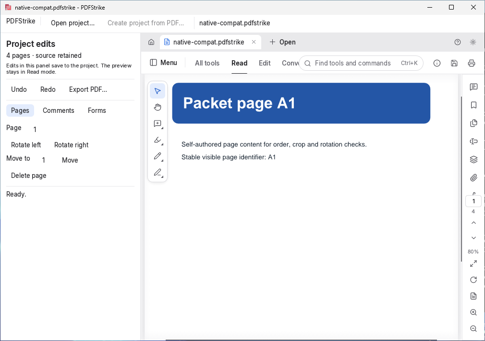
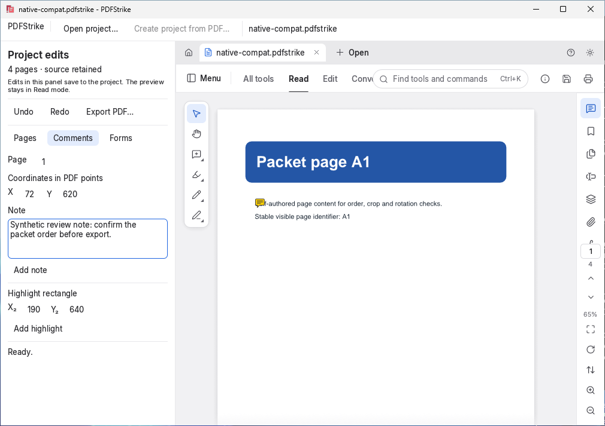
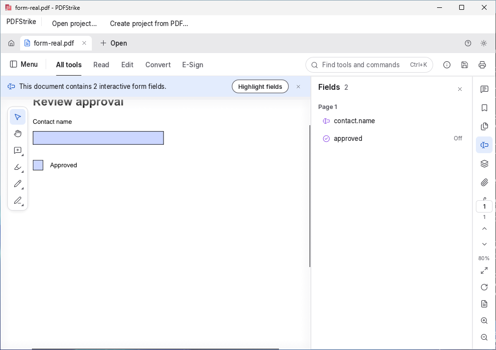

<p align="center">
  
</p>

<h1 align="center">PDFStrike</h1>

<p align="center">
  <a href="https://prowebdevsolutions.com"><picture>
    <source media="(prefers-color-scheme: dark)" srcset="assets/branding/PWDS-logo-orange.svg">
    
  </picture></a>
</p>

<p align="center"><strong>Make focused changes while keeping the original PDF.</strong></p>

PDFStrike pairs an editable `.pdfstrike` project with a new PDF export. Reorder or rotate pages, add a note or highlight, fill supported text and checkbox fields, then revise with undo and redo.

**Screenshot scope:** These native Windows screenshots were captured on October 21, 2026 from source `20deb626`, with the merged geometric app icon. The opened fixtures are self-authored test data. [Capture provenance](docs/SCREENSHOT_PROVENANCE.md) records the exact source, executable, hosted checks and image hashes.



*The checked-in four-page `native-compat.pdfstrike` project opened in the native project wrapper.*

<p align="center"><a href="#build-and-test">Build and test</a> · <a href="SOURCE_SCOPE.md">Source scope</a> · <a href="#current-status-and-limits">Project limits</a> · <a href="assets/branding">Original artwork</a></p>

## A project for each revision

### Arrange pages without changing the source

Create a project from a PDF, move, rotate, or delete a page, and keep the edits in a `.pdfstrike` archive. The tested Windows workflow rotated a self-authored page through the native UI, used Undo/Redo, and reopened the archive with the separate CLI. The original PDF bytes were unchanged.

### Add review marks and supported form values

The independently reviewed project subset covers manual-coordinate notes and highlights plus named text and checkbox AcroForm edits. It does not establish broad annotation compatibility, ink, arbitrary form types, or signed-file behavior.



*The native Comments panel saved the fictional note shown on page one. The capture helper also verified its text in the saved project journal.*



*The standalone `form-real.pdf` fixture shows `contact.name` and `approved` in the native Fields panel. This view does not demonstrate a project Forms edit or a populated field.*

### Export a separate PDF

Project export creates a **new** PDF and refuses an occupied destination or the source path. Keep the `.pdfstrike` file to revise edits later; exported pages are the shareable output.

## Build and test

This checkout has two Rust workspaces: the root CLI/core in `apps/pdfstrike` with `vendor/pdfcraft`, and the separate native editor/project core in `native/pdfstrike`. Their tested project archives interoperate for the reviewed subset, but the two cores are separate source revisions. Keep the directory layout and self-authored fixtures intact.

After ordinary crates.io dependencies are available, on Windows run:

```powershell
cargo test --locked -p pdfstrike
cd native/pdfstrike
cargo test --locked -p pdfstrike-project
cargo build --locked -p pdfstrike-native --bin pdfstrike-native
```

The captured source passed hosted checks: 57 redaction tests on Linux and Windows, plus 14 native project tests, 15 root CLI tests and one engine redaction transaction/undo control on Windows (144 passing test executions total). The Windows native editor built successfully, opened the checked-in synthetic project, saved the fictional note, and displayed the standalone form fixture. These are bounded source and hosted UI checks. [Screenshot provenance](docs/SCREENSHOT_PROVENANCE.md) records the capture and its limits; Room interactive and installer acceptance remain unverified.

## Current status and limits

This is a **Windows alpha source preview**; no installer is supplied. Hostile-PDF process isolation, real digitally signed files, power-loss recovery, broad annotations/forms, accessibility, and other platforms remain unvalidated. Project commands currently cover one-page move/delete/rotate, manual-coordinate note/highlight, named text/checkbox fields, and Undo/Redo. The retained PdfCraft raw-PDF editor exposes more toolbar items, but those items are **not** evidence that their edits persist in a `.pdfstrike` journal.

[SOURCE_SCOPE.md](SOURCE_SCOPE.md) records ownership and retained donor notices. No first-party license grant is stated for PDFStrike here. Explore the other [PWDS Strike repositories](https://github.com/Gerbzz?tab=repositories&q=Strike).

## PWDS brand artwork

The company mark in this masthead is the existing [official PWDS logo](https://github.com/Gerbzz/PWDS-Website/blob/main/public/prowebdevsolutions-logo.png), with the [official orange display asset](https://prowebdevsolutions.com/images/prowebdevsolutions-logo-orange.svg) for dark backgrounds. Any app logo above it remains the original Strike suite artwork.
